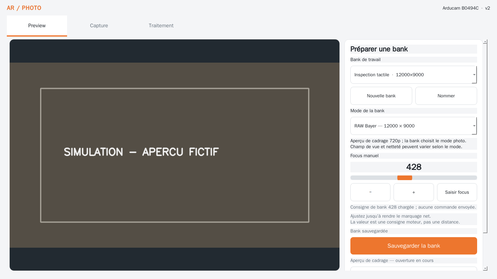

# Arducam Photo v2

Application locale Windows 11 x64 pour la caméra Arducam B0494C. Elle comporte
trois onglets intégrés — **Preview**, **Capture**, **Traitement** — et ne pilote
que le focus manuel. Elle n’ouvre ni navigateur ni serveur.

## État de livraison

Le dépôt contient une application Python/PySide6 exécutable, quatre modes de
capture strictement validés, les banks locales, l’archivage des originaux et les
traitements hors caméra. Les tests automatiques utilisent une caméra simulée ;
aucun essai sur Arducam ou pilote Windows n’a été effectué dans cet environnement.

L’ancien dépôt `MJOpeanuts/arducam_photo` a été consulté en lecture seule. La
copie locale `../arducam_photo` était absente. La référence confirme pour le RAW
le transport UVC 6000 × 9000, `CAP_PROP_CONVERT_RGB=0`, un buffer `uint8` exact
de 108 000 000 octets, puis sa reconstruction Bayer en 12000 × 9000. La v2
reprend ces invariants sans importer l’ancien code, ses banques ou préférences.

Capture d’interface à 1600 × 900 pixels avec une mire d’aperçu générée (aucune
caméra connectée) :



### Ressources et licences

Les icônes génériques Lucide de l’ancien projet indiquent une licence ISC, mais
la v2 ne les embarque pas. Le fichier `nuts-app.svg` et les logos « powered by »
n’ont pas de licence individuelle vérifiable dans l’ancien dépôt ; ils ne sont
donc pas copiés. L’interface v2 emploie une identité typographique et une
palette orange propres. Les mécanismes ISP et les cas synthétiques des tests
ont été examinés ; aucune capture d’écran de l’ancien projet n’est réutilisée.

## Installation et lancement depuis les sources

Prérequis : Windows 11 x64, Python 3.12 x64, accès au pilote Arducam/UVC pour
les fonctions caméra. Dépendances prises en charge : NumPy `>=1.26,<3`,
OpenCV headless `>=4.10,<5`, PySide6 Essentials `>=6.7,<7`. Dans PowerShell,
depuis la racine du dépôt (aucun chemin de dépôt installé n’est supposé) :

```powershell
py -3.12 -m venv .venv
.\.venv\Scripts\python.exe -m pip install -e ".[test]"
.\.venv\Scripts\python.exe -m arducam_photo_v2.app
```

L’application démarre sur Preview. Le mode d’aperçu est un transport couleur
720p indépendant du mode sauvegardé dans la bank. L’aperçu se libère en quittant
Preview. Capture n’ouvre pas de flux au repos ; Traitement ne possède aucun
chemin d’accès à la caméra.

## Interface et banks

Les cibles tactiles utilisent des dimensions minimales de 48 pixels logiques et
les curseurs/boutons ont des zones élargies. La boîte de dialogue intégrée
permet de saisir un nom ou un focus sans clavier physique. Qt 6 suit la mise à
l’échelle Windows ; la géométrie est exprimée en pixels logiques. Les facteurs
Windows 100 %, 125 % et 150 % restent à vérifier sur un écran tactile réel.

Le focus est une consigne entière de 0 à 1023, sans unité physique ni calibration.
La valeur reste « Focus non défini » tant que l’utilisateur n’en choisit pas une.
Le curseur envoie au relâchement et la saisie numérique à la validation. Le
rapport de commande, son acceptation/refus, la relecture et l’effet optique sont
distincts ; une commande acceptée ne signifie pas une mise au point réussie.

La bank sauvegardée est séparée de la copie de travail ; elle contient le mode
photo, le focus, le contexte caméra/backend, son identifiant, son schéma et sa
révision. Capture relit une bank sauvegardée puis en fige une copie. Modifier
n’enregistre rien, sauvegarder ne prend aucune photo. Le remplacement demande
confirmation. Les banks ne sont pas importées de l’ancien projet.

## Modes d’acquisition

| Mode | Données validées |
| --- | --- |
| `color_720p` | BGR uint8, 1280 × 720 |
| `color_4k` | BGR uint8, 3840 × 2160 |
| `color_12mp` | BGR uint8, 4000 × 3000 |
| `raw_108mp` | Bayer uint8 reconstruit, 12000 × 9000 ; transport 6000 × 9000 |

L’API OpenCV MSMF est sélectionnée explicitement, sans repli. Largeur/hauteur
et option RAW sont configurées, puis chaque image reçue est validée en type,
forme et nombre d’octets. Une configuration acceptée par le pilote ne suffit
pas. Une image non conforme ou un mode refusé produit une erreur visible.

Au déclenchement : la bank est figée, la caméra est ouverte/configurée, le focus
est appliqué, six images valides sont lues par défaut (cinq de stabilisation et
la dernière conservée), puis la caméra est libérée avant le rendu.

Les modes couleur archivent `reference.png`. Le RAW est archivé sans retouche
dans `original.raw` avant dématriçage ; `acquisition.json` partage le même
identifiant de capture et conserve le contexte, les dimensions et retours
disponibles, les durées, traitements et erreurs. Le rendu RAW de référence
applique le niveau noir 16, le dématriçage BayerGR2RGB et la correction couleur
4000 K. En cas d’échec du rendu, l’original et le manifeste restent présents.
Les noms sont uniques et les fichiers ne sont jamais remplacés.

## Traitement hors caméra

Ouvrir un manifeste d’acquisition JSON ou une image PNG/JPEG enregistrée. Les
traitements créent un nouveau fichier (PNG/JPEG) et refusent de remplacer la
source. Les opérations RAW sont dématriçage minimal, niveau noir + dématriçage
et rendu de référence corrigé. Le panneau source présente un rendu minimal
clairement nommé : le Bayer original n’est pas une photo couleur. Pour les
images couleur : niveaux de gris, contraste logiciel, réduction proportionnelle.
Le contraste de ce panneau ne produit aucune commande caméra.

## Stockage

- Banks et données d’application : `%LOCALAPPDATA%\ArducamPhotoV2\banks.sqlite3`.
- Photos, manifestes et rendus : `%USERPROFILE%\Pictures\ArducamPhotoV2` par
  défaut ; le dossier peut être choisi dans Capture.
- En l’absence de variables Windows, les données applicatives vont sous
  `~/AppData/Local/ArducamPhotoV2` et les photos sous `~/Pictures/ArducamPhotoV2`.

Ces emplacements sont propres à v2 et séparés du programme et de l’ancien
projet. La fermeture du Preview libère son flux ; « Relancer le Preview » ferme
puis rouvre le flux et ne réinitialise aucun réglage caméra. Les appels natifs
OpenCV bloquants ne promettent pas d’annulation instantanée.

## Tests et construction portable

Tests simulés :

```powershell
.\.venv\Scripts\python.exe -m pytest -q
```

Les 28 tests actuels passent sous Linux avec une caméra factice et Qt en mode
offscreen. Ils ne remplacent pas les essais Windows/Arducam.

Le build portable doit être exécuté sous Windows 11 x64 avec Python 3.12 x64 :

```powershell
powershell -ExecutionPolicy Bypass -File .\packaging\build_windows.ps1
```

Le script installe les dépendances de build et produit
`dist\ArducamPhotoV2.exe` (PyInstaller, mode fenêtre, fichier unique). Ce build
n’a pas été exécuté sur Windows. Un bundle PyInstaller Linux de contrôle a été
produit ici ; il ne valide ni l’exécutable Windows ni les pilotes caméra.

### Vérifications matérielles restantes

Les essais simulés ne valident ni le pilote, ni la prise en charge des formats,
ni la convention physique de Bayer, ni la netteté/couleur. Sur Windows et la
B0494C, vérifier séparément les quatre modes (USB 3 requis pour RAW), les formes
des buffers, la commande/relecture du focus, le rendu avec mire couleur, le
champ de vue et la netteté en mode photo, les captures successives et la
libération caméra. Vérifier aussi les facteurs 100/125/150 %, le tactile, et le
lancement de l’exécutable portable hors ligne.
