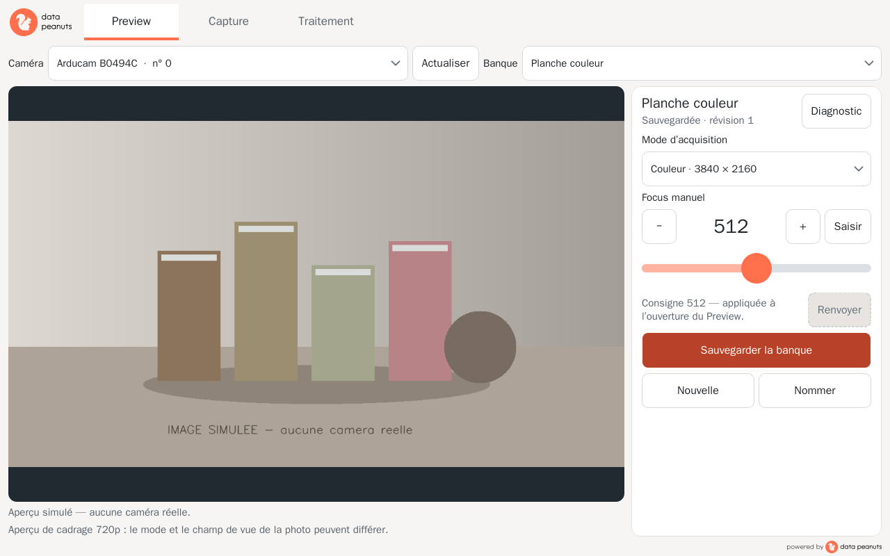

# Arducam Photo v2

Application locale Windows 11 x64 pour la caméra Arducam B0494C. Elle comporte
trois onglets intégrés — **Preview**, **Capture**, **Traitement** — et configure
le Mode d’acquisition et le Focus manuel. Elle n’ouvre ni navigateur ni serveur.

## État de livraison

Le dépôt contient une application Python/PySide6 exécutable, quatre modes de
capture strictement validés, les banques locales, l’archivage des originaux et les
traitements hors caméra. Les tests automatiques utilisent une caméra simulée ;
aucun essai sur Arducam ou pilote Windows n’a été effectué dans cet environnement.

L’ancien dépôt `MJOpeanuts/arducam_photo` a été consulté en lecture seule. La
copie locale `../arducam_photo` était absente. La référence confirme pour le RAW
le transport UVC 6000 × 9000, `CAP_PROP_CONVERT_RGB=0`, un buffer `uint8` exact
de 108 000 000 octets, puis sa reconstruction Bayer en 12000 × 9000. La v2
reprend ces invariants sans importer l’ancien code, ses banques ou préférences.

Captures d’interface après correction (Linux, Qt offscreen, image générée,
aucune caméra réelle) dans `docs/screenshots/` :
[Preview](docs/screenshots/preview.png),
[Capture](docs/screenshots/capture.png),
[Traitement](docs/screenshots/traitement.png). Les configurations réellement
contrôlées et la commande de reproduction sont précisées ci-dessous.



### Ressources visuelles et licences

Les logos fournis dans `assets/` (`logo_ref.png` pour l’en-tête,
`poweredby.png` pour le pied de page, `icon_ref.png` pour l’icône de fenêtre)
sont copiés à l’identique dans le package `src/arducam_photo_v2/resources/`
et lus via `importlib.resources` : aucun chemin absolu, aucun dossier externe,
aucun accès réseau. `app.ico` (16 à 256 px, carré, sans étirement) est généré
depuis `assets/icon_ref.png` par `python packaging/make_icon.py`.

L’icône `squirrel` provient de Lucide (commit `87a89b30`), embarquée telle quelle
dans `lucide-squirrel.svg` ; sa licence ISC est fournie dans
`resources/LICENSE-lucide.txt`. Elle sert de pictogramme secondaire (états sans
image) et accompagne le libellé « Capturer » du bouton de prise de photo,
jamais à la place du logo. Son rendu est décliné pour les états normal et
désactivé et les écrans haute résolution. La flèche des listes est l’icône Lucide
`chevron-down` (même licence), dont seule la couleur du trait est fixée.

## Installation et lancement depuis les sources

Prérequis : Windows 11 x64, Python 3.12 x64, accès au pilote Arducam/UVC pour
les fonctions caméra. Dépendances prises en charge : NumPy `>=1.26,<3`,
OpenCV `opencv-python >=4.10,<5` sous Windows (DirectShow et MSMF) ou
`opencv-python-headless >=4.10,<5` hors Windows, PySide6 Essentials `>=6.7,<7`,
cv2-enumerate-cameras `>=1.4,<2` (noms et chemins des périphériques). Dans PowerShell,
depuis la racine du dépôt (aucun chemin de dépôt installé n’est supposé) :

```powershell
py -3.12 -m venv .venv
.\.venv\Scripts\python.exe -m pip install -e ".[test]"
.\.venv\Scripts\python.exe -m arducam_photo_v2.app
```

Pour migrer un environnement Windows existant, le recréer avant l’installation :
les variantes `opencv-python` et `opencv-python-headless` ne doivent pas être
installées simultanément. L’application vérifie la disponibilité réelle de
MSMF au moment d’une capture RAW et s’arrête explicitement s’il manque ; elle
ne bascule pas sur DirectShow.

L’application démarre sur Preview. Elle ne choisit jamais de caméra
d’elle-même : la liste « Caméra » présente les périphériques (nom, index
OpenCV actuel, chemin matériel en info-bulle) ; « Actualiser » relance
l’énumération. L’aperçu permet de vérifier visuellement le choix. La caméra
choisie est enregistrée dans la banque (backend, nom, chemin matériel). L’index
OpenCV n’est pas une identité : au chargement d’une banque, la caméra est
retrouvée par son chemin matériel, sinon par son nom ; si elle est absente ou
ambiguë, une sélection est demandée. La session précédente est toujours
libérée avant l’ouverture d’un autre périphérique ; jamais deux accès simultanés.
Sous Windows, Preview et les captures couleur utilisent DirectShow (`DSHOW`).
Le RAW 108 MP utilise explicitement Media Foundation (`MSMF`), comme dans la
démo constructeur ; sous Linux il utilise V4L2. Chaque backend est vérifié avant
énumération/ouverture, sans repli. Pour le RAW, le périphérique choisi dans
Preview est retrouvé par chemin matériel ou nom sur MSMF ; un périphérique
absent ou ambigu arrête la capture.
Une banque enregistrée avec MSMF ne réimpose pas ce backend : sélectionnez à
nouveau sa caméra dans Preview puis sauvegardez-la. Aucun index n’est transposé
d’un backend à l’autre. Capturer exige le même contexte caméra que Preview.

Le mode d’aperçu est un transport couleur
720p indépendant du Mode d’acquisition sauvegardé dans la banque. L’aperçu se libère en quittant
Preview. Capture n’ouvre pas de flux au repos ; Traitement ne possède aucun
chemin d’accès à la caméra.

## Interface et banques

La police de l’interface est Segoe UI (substitution par Qt si absente).
Les textes courants sont à 15 px logiques, les boutons à 16 px, les onglets
et « Capturer » à 17 px, les titres à 20 px et la valeur du focus à 28 px.
La taille du texte est indépendante des cibles tactiles : au moins 48 × 48 px
pour les boutons et les lignes des listes, 56 px de haut pour le curseur.
La sélection des onglets utilise aussi un soulignement ; les boutons pressés
et désactivés ont des bordures distinctes. Pendant la capture, le déclencheur
est désactivé et indique « Capture en cours… », avec une barre de progression.
Les panneaux de commandes et Diagnostic peuvent défiler au toucher lorsque
l’espace disponible diminue, sans débordement horizontal.
La boîte de dialogue intégrée
permet de saisir un nom ou un Focus manuel sans clavier physique. Qt 6 suit la mise à
l’échelle Windows ; la géométrie est exprimée en pixels logiques. Les facteurs
Windows 100 %, 125 % et 150 % restent à vérifier sur un écran tactile réel.

Le Focus manuel est un entier de 0 à 1023, sans unité physique ni calibration.
La valeur reste « Focus manuel non défini » tant que l’utilisateur n’en choisit pas une.
Le curseur (zone tactile réelle de 56 px de haut) envoie au relâchement, la
saisie numérique à la validation ; − et + sont actifs dès la première consigne.
Seule la dernière consigne en attente est transmise. Charger une banque applique
son Focus manuel au Preview actif ; sans Preview actif, la consigne est appliquée à
l’ouverture de la session suivante. Les synchronisations d’affichage n’envoient
aucune commande. « Renvoyer » retransmet la même valeur après un refus. Les
résultats d’une ancienne session ou d’une consigne dépassée sont ignorés. Le
rapport de commande, son acceptation/refus, la relecture et l’effet optique sont
distincts ; une commande acceptée ne signifie pas une mise au point réussie.
Les explications et le journal sont dans « Diagnostic », accessible depuis
Preview et Capture. « Relancer le Preview » précède les paragraphes techniques.

La banque sauvegardée est séparée de la copie de travail ; elle contient son
identifiant et son nom, la caméra, le Mode d’acquisition, le Focus manuel et les
informations techniques de stockage. Après sauvegarde, la banque reste
sélectionnée dans Capture, qui affiche son nom, sa caméra, son Mode d’acquisition
et son Focus manuel ;
les sélections survivent aux rechargements et changements d’onglet. Capture
relit une banque sauvegardée puis en fige une copie. Modifier n’enregistre rien,
« Sauvegarder la banque » ne prend aucune photo. Le remplacement demande
confirmation. Les banques de l’ancien projet ne sont pas importées.

## Modes d’acquisition

| Mode | Données validées |
| --- | --- |
| `color_720p` | BGR uint8, 1280 × 720 |
| `color_4k` | BGR uint8, 3840 × 2160 |
| `color_12mp` | BGR uint8, 4000 × 3000 |
| `raw_108mp` | Bayer uint8 reconstruit, 12000 × 9000 ; transport 6000 × 9000, conversion couleur désactivée |

Les captures couleur utilisent l’API OpenCV DirectShow sous Windows ; le RAW
utilise MSMF explicitement (V4L2 sous Linux). Aucun changement de backend n’est
tenté en cas d’indisponibilité. Pour le RAW, largeur 6000, hauteur 9000 et
`CAP_PROP_CONVERT_RGB=0` sont configurés ; les 108 000 000 octets reçus sont
reconstruits en 9000 × 12000. Chaque image reçue est validée en type,
forme et nombre d’octets. Une configuration acceptée par le pilote ne suffit
pas. Une image non conforme ou un mode refusé produit une erreur visible.
Largeur et hauteur sont relues après l’ensemble des commandes du mode,
avant la stabilisation. Ces valeurs rapportées par le pilote peuvent encore
différer des dimensions reçues : elles sont diagnostiques, et ne remplacent
jamais la validation des pixels effectivement acquis.

Au déclenchement : la banque est figée, sa caméra est retrouvée, ouverte et
configurée, le Focus manuel est appliqué, puis une stabilisation bornée lit au plus
30 images. Lectures échouées, buffers non conformes (images transitoires après
changement de résolution) et images valides sont comptés séparément ; il faut
six images valides consécutives, la dernière est conservée. Si la limite est
atteinte, la capture échoue avec un message clair, sans repli de résolution ni
de backend. Les compteurs sont écrits dans `acquisition.json`
(`camera.stabilization`). La caméra est libérée avant le rendu.

Après un échec d’ouverture ou de lecture terminal, la caméra est libérée et
l’erreur reste affichée. Le Preview tolère au plus 30 lectures consécutives
échouées ou non conformes ; une exception de lecture termine immédiatement la
session. Aucune réouverture automatique n’est tentée, même après changement
d’onglet, de banque ou actualisation : utilisez « Relancer le Preview ».
Le diagnostic indique le backend choisi, sa disponibilité,
la caméra résolue (index courant et chemin) et les dimensions réellement reçues.
Les diagnostics de capture et ses erreurs y sont également conservés.

Si la libération matérielle échoue, les pixels acquis sont archivés, l’erreur
est affichée et la gestion caméra passe en défaut : Preview et Capture ne
rouvrent plus la caméra (aucune nouvelle tentative) et l’application demande
un redémarrage. Traitement reste utilisable.

Les modes couleur archivent `reference.png`. Le RAW est archivé sans retouche
dans `original.raw` avant dématriçage ; `acquisition.json` partage le même
identifiant de capture et conserve le contexte, les dimensions et retours
disponibles, les durées, traitements et erreurs. Le rendu RAW de référence
applique le niveau noir 16, le dématriçage constructeur BayerGR2RGB puis la
CCM interpolée à 4000 K depuis `arducam_108mp.json` à la racine du dépôt. Le
manifeste enregistre la recette, la température et l’empreinte SHA-256 du fichier ;
la sortie est BGR, comme attendu par l’encodage PNG et l’interface OpenCV/Qt.
Ce fichier constructeur fourni localement est ignoré par Git et n’est pas inclus
dans les paquets. S’il manque ou est invalide, le RAW et le manifeste sont
conservés, mais le rendu échoue avec une erreur explicite — aucune CCM de
remplacement n’est utilisée.
Les noms sont uniques et les fichiers ne sont jamais remplacés.

Après une capture réussie, le rendu apparaît automatiquement dans Capture,
sans changement d’onglet ni réouverture de la caméra. Le dossier de sortie
est résolu en chemin absolu au démarrage du worker ; les chemins
`original.path` et `render.path` du manifeste restent relatifs à leur dossier
de capture, jamais au répertoire de travail. La lecture des octets via Python
puis le décodage OpenCV prennent en charge les chemins Unicode.
Le worker transmet au thread graphique une image Qt autonome,
réduite à 1600 px maximum pour l’affichage uniquement. Les proportions sont
conservées, sans recadrage, et l’image s’adapte au redimensionnement.
La dernière photo affichée reste visible jusqu’au prochain résultat affichable.
Si le rendu ou son affichage échoue après sauvegarde, le message
« Photo enregistrée, affichage indisponible » apparaît avec le détail dans
Diagnostic ; les boutons d’ouverture de la photo (ou de l’original RAW si le
rendu manque) et du dossier restent disponibles. Aucune nouvelle prise
ni erreur d’acquisition n’est déclenchée pour cet échec d’affichage.
Diagnostic distingue sauvegarde, chargement et installation dans le widget,
avec leurs erreurs ; ces détails ne surchargent pas le statut principal.

Cause démontrée dans l’ancien code : un échec de `cv2.imread()` produisait
un résultat sauvegardé sans image d’affichage ni diagnostic. Le déclencheur
exact de l’incident Windows en couleur 12 MP (4000 × 3000) reste à confirmer
sur le PC : le traitement des chemins Unicode est une hypothèse, pas une
cause matérielle démontrée. La limite du lecteur PNG Qt concerne les grands
rendus, notamment le 108 MP ; elle n’explique pas l’incident 12 MP.

Ce n’est pas un décodage à faible consommation mémoire : OpenCV décode
l’image entière avant réduction (324 Mo de pixels BGR pour 108 MP, hors
buffers temporaires). Les pixels acquis sont libérés après archivage, avant
ce chargement ; les octets compressés et le tableau décodé ne sont pas
conservés après création de l’image d’affichage. Une capture en cours bloque
les déclenchements suivants jusqu’à la fin du worker, donc leurs chargements
ne s’accumulent pas. La copie Qt est nécessaire pour détacher le petit buffer
d’affichage de NumPy.

Mesure Linux/Python 3.12 en processus séparés, cinq chargements consécutifs
d’un PNG synthétique uniforme, en conservant le dernier résultat :
12 MP, RSS initiale 79,9 Mio, pic 168,2 Mio, RSS après chargements
88,7 / 94,0 / 99,4 / 99,5 / 99,5 Mio ; 108 MP, RSS initiale 80,1 Mio,
pic 717,8 Mio, puis 89,0 / 94,3 / 99,7 / 99,8 / 99,8 Mio.
Après libération du résultat : 83,2 et 83,5 Mio respectivement.
Ces mesures concernent uniquement le chargement, pas l’acquisition ni
le dématriçage ; la compression du fichier, l’allocateur et Windows peuvent
changer les pics. Il reste à mesurer une séquence réelle sur le PC.

## Traitement hors caméra

Ouvrir un manifeste d’acquisition JSON ou une image PNG/JPEG enregistrée. Les
traitements créent un nouveau fichier (PNG/JPEG) et refusent de remplacer la
source. Les chemins du manifeste sont résolus depuis le dossier du manifeste ;
les images sont décodées depuis leurs octets pour gérer aussi les chemins
Windows avec espaces et accents. Les opérations RAW sont dématriçage minimal,
niveau noir + dématriçage et rendu de référence corrigé. Le panneau source présente un rendu minimal
clairement nommé : le Bayer original n’est pas une photo couleur. Pour les
images couleur : niveaux de gris, contraste logiciel, réduction proportionnelle.
Le contraste de ce panneau ne produit aucune commande caméra.

## Stockage

- Banques et données d’application : `%LOCALAPPDATA%\ArducamPhotoV2\banks.sqlite3`.
  Ce stockage de réglages a changé de format : une base antérieure ou illisible
  est réinitialisée (réglages vides) et un avis est affiché en pied de page.
  Aucun import des anciens réglages ; photos, RAW et manifestes ne sont jamais
  touchés.
- Photos, manifestes et rendus : `%USERPROFILE%\Pictures\ArducamPhotoV2` par
  défaut ; le dossier peut être choisi dans Capture.
- En l’absence de variables Windows, les données applicatives vont sous
  `~/AppData/Local/ArducamPhotoV2` et les photos sous `~/Pictures/ArducamPhotoV2`.

Ces emplacements sont propres à v2 et séparés du programme et de l’ancien
projet. La fermeture du Preview libère son flux ; « Relancer le Preview » ferme
puis rouvre le flux et ne réinitialise aucun réglage caméra. Les appels natifs
OpenCV bloquants ne promettent pas d’annulation instantanée.

## Tests et construction portable

Tests simulés :

```powershell
.\.venv\Scripts\python.exe -m pytest -q
```

Les tests s’exécutent sous Linux (Python 3.12, `QT_QPA_PLATFORM=offscreen`)
avec une caméra et un énumérateur factices. Ils couvrent aussi la disponibilité
des backends, la résolution des index, les échecs terminaux et la relance manuelle.
Ils ne remplacent pas les essais Windows/Arducam.
Le transfert worker → interface est testé dans les quatre modes avec des
acquisitions synthétiques (12 MP aux dimensions réelles, autres modes réduits),
un archivage et un décodage réels, des chemins relatifs avec espaces/accents
depuis un autre répertoire de travail et des signaux entre threads.
Les tests vérifient
aussi le décodage aux dimensions réelles des quatre rendus, le redimensionnement,
la conservation du fichier et de la dernière
image affichée, ainsi que les échecs de rendu/décodage après sauvegarde.
Ces vérifications sont simulées : aucun essai matériel supplémentaire
Windows/Arducam n’est attesté par ces tests.

### Contrôle visuel de l’interface

Les trois onglets ont été contrôlés sous Linux/Qt offscreen aux six
configurations suivantes. Les dimensions de fenêtre sont celles de la zone
cliente, en **pixels logiques** ; les facteurs Qt simulent la densité d’affichage,
pas le rendu natif de Windows.

| Fenêtre logique | Capture à 100 % | Capture à 125 % | Capture à 150 % |
| --- | --- | --- | --- |
| 1280 × 800 | 1280 × 800 px | 1600 × 1000 px | 1920 × 1200 px |
| 1920 × 1080 | 1920 × 1080 px | 2400 × 1350 px | 2880 × 1620 px |

Les fichiers suivent les noms `preview`, `capture`, `traitement` : sans suffixe
pour 1280 × 800 à 100 %, suffixe `-125` / `-150` pour cette même fenêtre,
`-1920`, `-1920-125`, `-1920-150` pour 1920 × 1080.
Les contrôles couvrent aussi les claviers de nom et de focus, les dialogues
Diagnostic, modifications non sauvegardées, erreur et ouverture de fichier
(version Qt non native), le bouton pressé et la capture en cours, les erreurs
Preview/Capture/Traitement et le défaut de libération caméra.
Les captures de ces états à 1280 × 800 et 100 % sont également conservées.
La hauteur des textes repliés, la lisibilité complète des boutons et leur
accessibilité sont contrôlées par le script, en plus de la revue des images.

Les espaces logiques réduits correspondant à des fenêtres **physiques**
1280 × 800 et 1920 × 1080 ont également été contrôlés : respectivement
1024 × 640 / 853 × 533 à 125 % / 150 %, et 1536 × 864 / 1280 × 720.
Les panneaux défilent si nécessaire : le résumé reste complet, le déclencheur
de capture reste visible et les autres actions restent accessibles au toucher.
Les trois vues du cas physique 1280 × 800 à 150 % sont conservées sous
`*-physical-1280-150.png`. Pour reproduire ce cas, ajouter `--allow-scroll`
et utiliser `--width 853 --height 533` avec `QT_SCALE_FACTOR=1.5`.

Reproduction depuis la racine, après installation des dépendances de test :

```bash
QT_QPA_PLATFORM=offscreen:configfile=tests/qt_offscreen.json \
QT_SCALE_FACTOR=1.25 .venv/bin/python tests/capture_ui.py \
  --width 1280 --height 800 --states
```

L’écran virtuel de 3840 × 2160 évite que l’écran offscreen par défaut de
800 × 800 ne comprime artificiellement les dialogues. Aucun périphérique
n’est ouvert et les banques de démonstration sont dans un dossier temporaire.
Les facteurs Windows réels, les dialogues natifs, le tactile matériel et la
caméra restent à vérifier sur Windows.

Le build portable doit être exécuté sous Windows 11 x64 avec Python 3.12 x64 :

```powershell
powershell -ExecutionPolicy Bypass -File .\packaging\build_windows.ps1
```

Le script installe les dépendances de build et produit
`dist\ArducamPhotoV2.exe` (PyInstaller, mode fenêtre, fichier unique, icône
`app.ico`, ressources visuelles et `cv2_enumerate_cameras` embarqués). Ce build
n’a pas été exécuté sur Windows. Un bundle PyInstaller Linux de contrôle a été
produit ici ; il ne valide ni l’exécutable Windows ni les pilotes caméra.

### Vérifications matérielles restantes

Un essai antérieur sur le PC Windows (Python 3.12.10, OpenCV headless
4.14.0.94) a validé l’ouverture DirectShow et une lecture couleur de forme
`(720, 1280, 3)`, mais MSMF y était indisponible. Après recréation de
l’environnement avec la dépendance Windows déclarée ici, la disponibilité MSMF
doit encore être vérifiée sur ce PC. Cela ne valide ni le Focus manuel, ni les
captures dans les quatre modes, ni les modes 4K, 12 MP ou RAW 108 MP.

Les essais simulés ne valident ni le pilote, ni la prise en charge des formats,
ni la convention physique de Bayer, ni la netteté/couleur. Sur Windows et la
B0494C, vérifier séparément les quatre modes (USB 3 requis pour RAW), les formes
des buffers, la commande/relecture du Focus manuel, le rendu avec mire couleur, le
champ de vue et la netteté en mode photo, les captures successives et la
libération caméra. Vérifier aussi : noms/chemins listés par DirectShow et
correspondance avec l’index OpenCV, débranchement/rebranchement et deux
caméras identiques, nombre réel d’images transitoires après changement de
résolution, comportement en cas d’échec de libération, facteurs 100/125/150 %,
le tactile, l’icône de l’exécutable et le lancement portable hors ligne.
